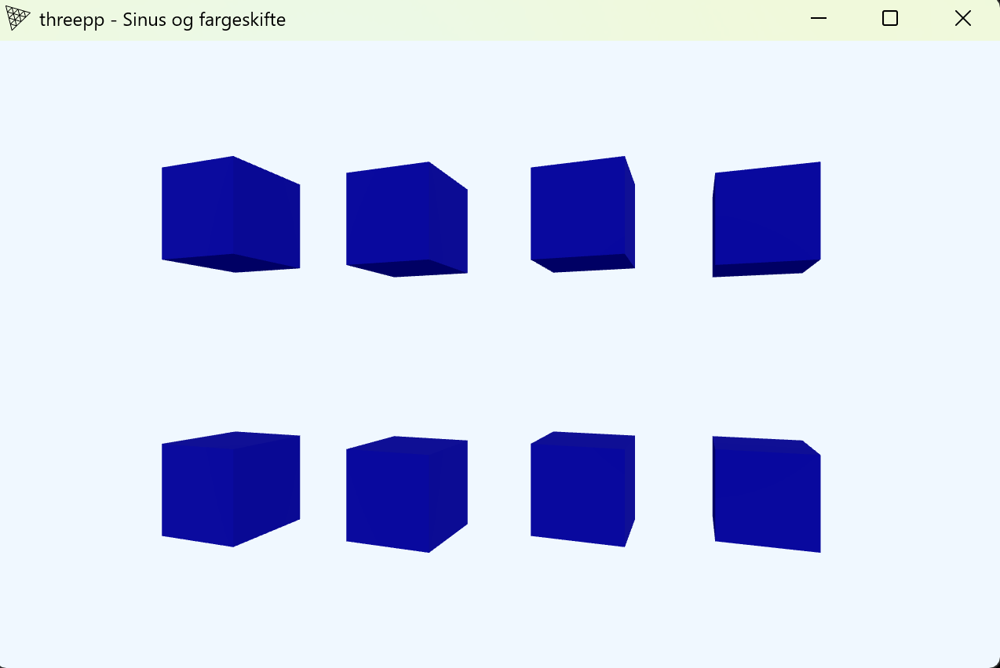

**Beskrivelse av hva koden gjør:**

Programmet viser 8 blå kuber, fordelt på 2 rader.

Kubene roterer rundt seg selv, samtidig som de følger en sinuskurve. 

Annenhver kube beveger seg motsatt av den neste.

Antall kuber kan enkelt endres med variabelen "antallKuber" i main.cpp

Trykker man på space endrer rad 1 farge fra blå, til oransje. 

Trykker man på space igjen, endrer rad 2 farge til oransje.

Trykker man en tredje gang, resettes begge radene tilbake til fargen blå. 

**Bildet av programmet:**

